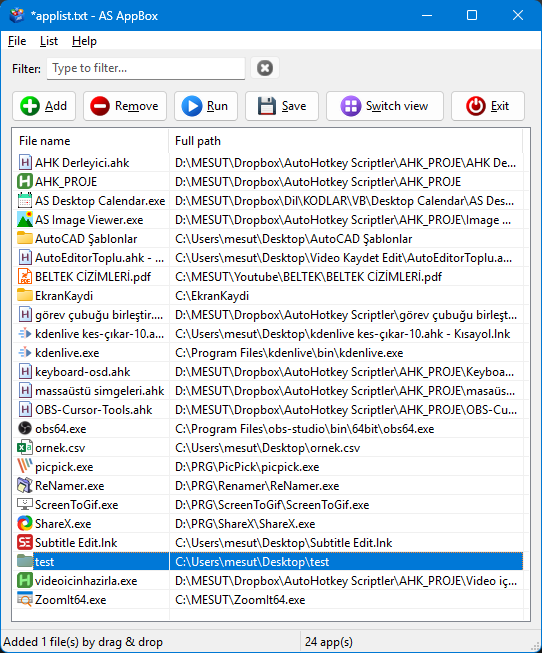

# AS AppBox

AS AppBox is an application manager that helps you organize and quickly launch your favorite programs. Built with AutoHotkey v2, it offers a modern and user-friendly interface.\

## Features

- Add and remove applications from your list
- Run selected applications with one click
- Filter applications by file name or full path with real-time search
- Manage multiple application lists: open, save, and save as separate `.txt` files
- Restore the last-used list on startup
- Drag and drop support for adding apps
- Context menu for quick actions
- Multiple view modes (list/icon with small and large icons)
- Open file locations in Explorer
- Copy the full path(s) of selected applications
- Column sorting (click column headers to sort, remembers preference)
- Window title shows the active list name and marks unsaved changes with `*`
- Window position, size, view mode, sort order, and active list remembered across sessions
- Toolbar buttons with custom icons (via IconButton class)
- Compilable to standalone EXE (Ahk2Exe directives included)
- Automatic legacy encoding migration (ANSI → UTF-8)
- Atomic file saving (write to .tmp, then rename) for data safety
- Multi-item removal confirmation dialog
- Keyboard shortcuts help dialog

## Files

| File | Description |
|------|-------------|
| `src/AppBox.ahk` | Main application script |
| `src/IconButton.ahk` | Icon button class: custom buttons with icon support, grayscale on disabled, DPI-aware |
| `src/Lists/applist.txt` | Default application list (created automatically) |
| `src/settings.ini` | User preferences, including window state, view/sort settings, and last-used list (created automatically) |
| `src/icons/` | Toolbar icon files (.ico) used by the source script |

## Installation & Run

### Option 1: Run the compiled EXE (recommended)

1. Go to the [Releases](https://github.com/mesutakcan/AS-AppBox/releases) page.
2. Download the latest `AppBox.exe` file.
3. Double-click `AppBox.exe` to run. No installation or dependencies required.

> **Note:** The EXE is a standalone portable application. All icon files are embedded in the executable, so no additional files are needed.

### Option 2: Run from source (AHK script)

1. Install [AutoHotkey v2](https://www.autohotkey.com/).
2. Download the project and keep the `src/` folder structure intact, including `AppBox.ahk`, `IconButton.ahk`, and the `icons/` folder.
3. Double-click [src/AppBox.ahk](src/AppBox.ahk) to run.

## Usage

- **Add:** Add new applications to your list (files or folders).
- **Remove:** Remove selected applications.
- **Run:** Launch selected applications.
- **Save:** Save your application list.
- **Open list / Save list as:** Open another list or save the current list to a separate `.txt` file from the File menu.
- **Switch view:** Cycle through four view modes: list with small icons, list with large icons, icon view with small icons, icon view with large icons.
- **Exit:** Exit the application.
- **Clear filter (×):** The small button next to the filter box clears the current filter text.
- The window title shows the active list file name. An asterisk (`*`) indicates unsaved changes.

### Keyboard Shortcuts

#### Anywhere
| Key | Action |
|-----|--------|
| `Ctrl+F` | Go to the filter box |
| `Ctrl+O` | Open a list |
| `Ctrl+Shift+S` | Save list as |
| `Insert` | Add applications |
| `Ctrl+S` | Save list |
| Drag & drop | Add files or folders |

#### Filter Box
| Key | Action |
|-----|--------|
| `Esc` | Clear the filter |
| `Down` | Move to the list |

#### List
| Key | Action |
|-----|--------|
| `Enter` / `Numpad Enter` | Run selected |
| `Del` | Remove selected |
| `Ctrl+A` | Select all |
| `Esc` | Deselect all |
| Click column header | Sort the list |

## History

- **v1.2** : 2026-10-21
  - Added support for multiple named application lists, with Open List and Save List As commands
  - Added `Ctrl+O` to open a list and `Ctrl+Shift+S` to save the current list under a new name
  - Saves the active list path in `settings.ini` and restores that list on startup
  - Moved the default list to the `Lists/` directory and added migration from the previous root-level `applist.txt`
  - Added a separate file-name column and filtering by file name or full path
  - Added a `*` marker for unsaved changes to the active list in the window title
  - Added list read error handling and a shared atomic writer for Save and Save As
  - Centralized adding files from the picker and drag-and-drop, with duplicate counts in the status bar
  - Added a trailing slash to drive-root working directories when launching applications

- **v1.1** : 2026-10-13
  - Added `IconButton.ahk`: custom button class with icon support, grayscale-on-disabled, and DPI awareness
  - Toolbar buttons now display custom icons (.ico files) instead of Segoe MDL2 Assets font characters
  - Added Ahk2Exe compiler directives for building standalone EXE
  - Replaced manual ImageList icon loading with Windows system icon list (`SHGetFileInfoW` with `SHGFI_SYSICONINDEX`) for faster, lower-memory icon display
  - Intelligent icon caching: per-extension cache for common file types, per-path cache for unique types (exe, lnk, ico, etc.)
  - Added `settings.ini` support: window position/size, view mode, and sort preferences are now saved and restored across sessions
  - Added column header click sorting with ascending/descending toggle
  - Added Keyboard Shortcuts dialog in Help menu
  - Added `Ctrl+F` shortcut to focus the filter box
  - Added cue banner (placeholder text) in the filter input
  - Filter box keyboard navigation: `Esc` clears filter, `Down` moves focus to the list
  - Added `Enter` / `Numpad Enter` hotkeys to run selected applications from the list
  - Debounced filter input (100 ms delay) for smoother typing experience
  - Context-sensitive hotkeys: `Del`, `Ctrl+A`, `Esc`, `Enter` only active when list is focused; `Insert` disabled while filter is focused
  - Atomic file saving: writes to `.tmp` file first, then renames for data safety
  - File saving and loading now use UTF-8 encoding
  - Automatic legacy encoding migration: detects ANSI-encoded list files and converts to UTF-8
  - Multi-item removal now shows a confirmation dialog
  - Close dialog now includes a Cancel option (in addition to Yes/No)
  - Save on close verifies success before exiting
  - `Run` now uses working directory parameter instead of `RunWait`
  - Duplicate checking uses `Map` (O(1) lookup) instead of linear array search
  - StatusBar shows filtered count (e.g., "5 of 12 app(s)")
  - StatusBar divided into parts for better information display
  - File selection dialog now allows selecting folders as well (`M35` flag)
  - Changed default font to Segoe UI
  - Improved minimum window size (540×570)
  - Window state saved on close (position, size)
  - Various code refactoring and improvements

- **v1.0** : 2025-04-25
  - First version

## Credits

- [IconButton](https://github.com/mesutakcan/IconButton): AHK v2 button class with icon support, grayscale on disabled, and DPI awareness. By Mesut Akcan.

## Contributing

Contributions are welcome! If you'd like to add features, fix bugs, or improve the code, feel free to open a pull request.

## Developer

Mesut Akcan
- [mesutakcan.blogspot.com](https://mesutakcan.blogspot.com)
- [youtube.com/mesutakcan](https://youtube.com/mesutakcan)
- [github.com/mesutakcan](https://github.com/mesutakcan)

